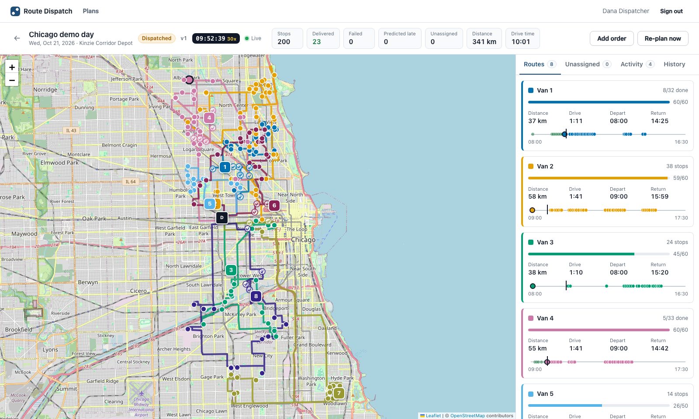
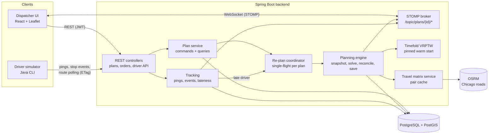

# Route Dispatch Platform

Plans delivery routes for a small courier, food bank or local delivery business, then keeps those routes right
while the day happens.

A dispatcher uploads the day's orders (for example 200 Chicago addresses, each with a delivery window and a
package size) and the fleet (8 vans with a capacity, a driver shift and a home depot). The platform:

1. **Plans every van's route on real roads.** It solves the vehicle routing problem with time windows and
   capacity (VRPTW) using road travel times from a self-hosted OSRM server built from OpenStreetMap.
2. **Shows the plan on a live dispatcher map** with each route's road geometry, ETAs against delivery windows, and
   van load.
3. **Streams drivers' GPS positions to the map in real time** over WebSocket (STOMP).
4. **Re-plans in seconds** when a new order arrives or a driver runs late. Only unvisited stops are re-optimized;
   stops a driver has completed, reached, or is currently driving to are pinned and never reshuffled.
5. **Tracks stop status** (pending, en route, arrived, delivered, failed) from driver events, safely: duplicate or
   out-of-order GPS pings and events cannot corrupt state.

A driver simulator drives the fleet along the planned road geometry so all of this can be seen without phones.



*The seeded Chicago day mid-morning, running at 30x speed: 8 routes on real roads, numbered van markers moving
from live GPS, delivered stops checked off, and a timeline per van. More screenshots: [adding an order
mid-shift](docs/screenshots/add-order-mid-shift.png), [the re-plan that follows](docs/screenshots/replanned.png),
[activity feed](docs/screenshots/activity-feed.png), [plan history](docs/screenshots/plan-history.png),
[plan list](docs/screenshots/plans.png).*

## Results (measured, see [Benchmarks](#benchmarks))

All numbers come from the benchmark scripts in this repository, run on an Apple M2 laptop (details below).

| What | Measured |
| --- | --- |
| Driving distance for the seeded 200-stop, 8-van Chicago day (OSRM road distances) | **334.2 km** optimized, vs 597.2 km nearest-neighbor (**44.0% less**) and 1,889.3 km round-robin (**82.3% less**) |
| Driving time, same day | **9.9 h** vs 15.3 h nearest-neighbor (35.3% less) and 40.7 h round-robin (75.7% less) |
| Deliveries inside their time window | **200 of 200 (100%)** vs 174 of 200 (87.0%) nearest-neighbor and 87 of 200 (43.5%) round-robin |
| Solve time, 200 stops / 8 vans | first feasible plan after 0.46 s; within 1% of the 60-second result after 25.7 s |
| Re-plan after one order is added mid-shift, through the API while 8 simulated vans drive (28 to 30 stops pinned) | median **1.48 s**, slowest of 10 runs 2.47 s, from the POST to the dispatcher receiving the new plan; 10 of 10 orders routed |
| GPS ingest, 400 vans each sending 1 ping per second | 406.7 pings/s accepted, 0 errors, **p95 5.0 ms** per request, p95 4.8 ms from ping to the dispatcher's WebSocket |
| GPS ingest ceiling, same setup | 2,041 pings/s accepted at 2,000 offered (p95 432 ms); throughput tops out at 2,370.6 pings/s when 4,000/s are offered |

## Features

- **Route optimization:** Timefold Solver VRPTW model with hard constraints (van capacity, delivery windows,
  driver shift end), a medium constraint (every order on a route), and soft constraints (total driving time,
  lateness against the ETA already promised to the customer). Constraints are unit-tested with Timefold's
  `ConstraintVerifier`.
- **Real road distances:** OSRM table and route APIs against a Chicago OpenStreetMap extract. A 200-stop day is a
  201 x 201 matrix (40,401 pairs); every pair is cached, and adding one order fetches only its row and column
  (1 x 201 + 200 x 1 pairs). A haversine provider with the same interface is used in tests or when OSRM is not
  available (`ROUTING_PROVIDER=haversine`).
- **Warm-started re-planning with pinning:** the current routes are the starting solution; visited and in-progress
  stops form a pinned prefix (`@PlanningPinToIndex`) with their real times; vans cannot leave before "now".
  Re-plans run one at a time per plan, and requests that arrive during a run are merged into one follow-up.
  Driver events that arrive while the solver runs win over the solver's answer (reconciliation on save).
- **Late driver detection:** a stop reached more than 10 plan-minutes after its ETA, or a stop being driven to
  whose ETA passed 10 minutes ago, triggers a re-plan for the rest of the day (with a per-van cooldown).
- **Live tracking:** GPS ping ingest on a plain-SQL hot path (idempotent insert by client ping id, latest position
  upsert that only moves forward in time), pushed to dispatchers over STOMP. PostGIS powers "nearest vans to this
  address" (KNN on a GiST index) and each van's driven trail (`ST_MakeLine` over its pings).
- **Idempotent driver events:** each event carries a client UUID; retries return the original outcome, and the
  stop state machine only moves forward, so late or repeated events are recorded but ignored.
- **Security:** JWT bearer tokens (HS256, Spring Security resource server) with DISPATCHER and DRIVER roles.
  Drivers can only report on stops of their own van. WebSocket sessions authenticate on STOMP CONNECT and only
  dispatchers may subscribe to plan topics.
- **Dispatcher UI:** React + TypeScript + Leaflet map with OpenStreetMap tiles, colored route polylines, live van
  markers, CSV upload with row-level error reporting, add-an-order by clicking the map, per-route timelines (ETA
  vs window, load), activity feed, re-plan banner highlighting the vans that changed, and plan history.
- **Accelerated plan clock:** a dispatched day runs at a chosen speed (for example 30x) so a 10-hour day can be
  watched in about 20 minutes. All ETAs, lateness and re-plans use the plan clock.
- **API docs:** OpenAPI / Swagger UI at `http://localhost:8080/swagger-ui.html`; errors are RFC 9457 problem
  details.

## Architecture



Backend packages are organized by feature (`backend/src/main/java/com/routedispatch`):

| Package | Responsibility |
| --- | --- |
| `routing` | `TravelTimeProvider` port with OSRM and haversine adapters; cached `TravelMatrixService` |
| `optimization` | Timefold planning model (`VehicleRoute`, `Visit`), constraints, `RouteOptimizer`, baseline planners |
| `plan` | Plan, stop and route entities; commands (`PlanService`); the planning engine, pinning snapshot, reconciliation, re-plan coordinator, plan clock, CSV import |
| `plan.api` | REST controller, read models and query service for the dispatcher |
| `tracking` | Driver API, GPS ingest, stop events, lateness monitor, PostGIS queries |
| `realtime` | STOMP configuration, token authentication for WebSocket sessions, publisher |
| `security` | Users, JWT issuing and verification, role rules |
| `fleet` | Depots and vans |
| `demo` | Seeded Chicago day generator and demo data |
| `benchmark` | Offline routing benchmark CLI |

The solver model is kept separate from the JPA entities: the planning engine maps stored state into
`VehicleSpec` / `VisitSpec` inputs, so the optimizer and benchmark run without Spring or a database.

### Re-plan flow

```mermaid
sequenceDiagram
    participant D as Dispatcher UI
    participant A as API
    participant C as Re-plan coordinator
    participant E as Planning engine
    participant S as Timefold
    participant V as Driver devices
    D->>A: POST /api/plans/{id}/orders
    A->>C: request(NEW_ORDER) after commit
    C->>E: run (one job per plan at a time)
    E->>E: snapshot: pin delivered, arrived and en-route stops; now = plan clock
    E->>S: warm start from current routes, insert new order
    S-->>E: best solution (seconds)
    E->>E: OSRM geometry for changed routes; reconcile with events that arrived meanwhile
    E->>A: save stops, ETAs, routes, revision (version + 1)
    E-->>D: PLAN_UPDATED over STOMP
    V->>A: GET /api/driver/route (If-None-Match) returns the new version
```

## Tech stack

- **Backend:** Java 21, Spring Boot 3.5 (Web, Data JPA, Security with OAuth2 resource server JWT, WebSocket/STOMP,
  Validation, Actuator), Flyway, Hibernate Spatial with JTS, springdoc-openapi, Caffeine, Apache Commons CSV,
  Gradle wrapper.
- **Optimization and maps:** Timefold Solver 2.7 (community edition), OSRM 5.27 (MLD) on an OpenStreetMap extract
  of the Chicago area (BBBike), PostgreSQL 17 with PostGIS 3.5.
- **Frontend:** React 19, TypeScript, Vite, react-leaflet, TanStack Query, @stomp/stompjs, Vitest, React Testing
  Library, ESLint.
- **Tests:** JUnit 5, Mockito, AssertJ, Testcontainers (PostGIS), Spring Boot slice tests, STOMP WebSocket
  integration tests, Timefold `ConstraintVerifier`, JaCoCo.
- **Ops:** Docker Compose, Makefile, GitHub Actions.

## Running locally

Requirements: Docker (Docker Desktop or Colima), JDK 21, Node 22 or newer, about 1 GB of disk for map data.
Nothing needs a cloud account or an API key.

```bash
make setup      # downloads the Chicago OSM extract (103 MB) and builds the OSRM dataset, installs dependencies
make run        # starts PostGIS, OSRM, backend (demo data) and UI
```

Open http://localhost:3000 and sign in as `dispatcher@demo.local` / `dispatch-demo`. The "Chicago demo day"
plan holds 200 seeded orders; press **Optimize**, then **Dispatch**.

```bash
make simulate               # optimizes and dispatches the demo day if needed, then drives 8 vans (30x speed)
make simulate SPEED=60      # faster day
```

While the vans drive, click **Add order** and click the map: the new order is inserted into a route in a couple
of seconds while every completed or in-progress stop stays where it is. Van 3 is scripted to get stuck in traffic
after 10:30 (plan time), which triggers a late-driver re-plan on its own.

Other useful commands:

```bash
make stop / make reset      # stop the stack; reset also deletes the database volume
make logs                   # backend logs
make sample-data            # regenerate sample-data/chicago-200-orders.csv (upload it in the UI)
```

Development without Docker for the app itself: start `docker compose up -d postgis osrm`, then
`SPRING_PROFILES_ACTIVE=demo DB_URL=jdbc:postgresql://localhost:5433/dispatch OSRM_URL=http://localhost:5001 ./gradlew :backend:bootRun`
and `cd frontend && npm run dev` (http://localhost:5173, proxies to the backend). Without OSRM, set
`ROUTING_PROVIDER=haversine`.

Demo logins (local only, created by the `demo` profile): dispatcher `dispatcher@demo.local` / `dispatch-demo`;
drivers `driver1@demo.local` to `driver8@demo.local` / `driver-demo`.

## Testing

```bash
make test     # backend + simulator (JUnit, Testcontainers PostGIS, JaCoCo) and frontend (Vitest)
make lint     # ESLint (zero warnings) and Java compilation with all lint warnings enabled
```

Results of the final run (`./gradlew build` and `npm test`):

| Suite | Tests | Result |
| --- | --- | --- |
| Backend unit tests (solver constraints and schedule, routing adapters and cache, CSV parser, state machine, snapshot pinning, reconciliation, coordinator, lateness monitor, generator, baselines) | 80 | all pass |
| Backend WebMvc slice tests (controller, validation, error mapping, security rules) | 7 | all pass |
| Backend integration tests (Testcontainers PostGIS through the real HTTP and security stack; real-port STOMP WebSocket and gzip tests) | 37 | all pass |
| Simulator unit tests | 18 | all pass |
| Frontend (Vitest + React Testing Library, 12 files) | 36 | all pass |

Backend coverage (JaCoCo; excludes only the `main` class, the benchmark CLI and the CSV export CLI): **93.1% of
lines**, 92.9% of instructions, 78.9% of branches. Frontend line coverage is 42.8%: logic, hooks and forms are
unit-tested, while map and page components are checked in a real browser instead (Playwright runs against the
Docker stack, which also produced the screenshots).

What the tests cover:

- **Solver:** every constraint through `ConstraintVerifier` (capacity, windows, shift end, unassigned, driving
  time, committed-ETA lateness, already-happened lateness excluded); schedule rules (waiting for window start,
  fixed times, "not before now"); solver integration tests including a re-plan that must keep a pinned prefix
  (verified by mutation: disabling pinning makes it fail).
- **Re-planning:** snapshot pinning and fixed-time estimates, reconciliation with events that arrived during a
  solve, request coalescing in the coordinator, late-driver detection and cooldown, end-to-end re-plans through
  the HTTP API for a new order and for a late driver.
- **Tracking:** duplicate pings stored once, older pings never move a van backwards, future-dated pings rejected,
  duplicate and backward stop events, a driver reporting on another van's stop (403), ETag polling (304), KNN
  nearest vans and GPS trails in PostGIS.
- **Security and realtime:** role rules on every API, forged tokens, login failures, a WebMvc slice with the real
  security configuration, and STOMP over a real WebSocket: connection without or with a bad token refused, a
  driver refused on dispatcher topics, a dispatcher receiving a driver's position live.
- **Data and API:** Flyway schema on PostGIS, geography round trips, wall-clock `TIME` columns, CSV import
  validation (row-level errors, all-or-nothing), problem-detail errors, gzip responses.
- **Frontend:** login, CSV import errors, add-order validation, route timeline rendering, live position ordering,
  plan diffing and the API client.

## Benchmarks

Everything below was measured with the commands shown, and the raw output is in
[`benchmarks/results/`](benchmarks/results/). One seeded day, one machine: treat these as indicative, not as a
general claim about VRP solvers.

**Hardware and setup.** Apple M2 (8 cores: 4 performance, 4 efficiency), 8 GB RAM, macOS 26.5.1, OpenJDK
21.0.13. Docker runs in a Colima VM with 4 vCPUs and 5 GB. The routing benchmark runs on the host JVM (2 GB
heap) against OSRM in Docker. The API benchmarks hit the backend container, with the load generator on the
same laptop, competing for the same CPU.

### Route quality: optimized vs naive plans

```bash
make benchmark        # = ./gradlew :backend:benchmark -PbenchmarkArgs="--osrm-url http://localhost:5001"
```

- **The day:** `ChicagoDayGenerator` with seed 42, the same day the demo loads. It has 200 orders on real Chicago
  grid streets across 14 neighborhoods. Delivery windows are 20% any time (9 to 17), 20% morning (9 to 12), 20%
  afternoon (13 to 17) and 40% booked two-hour slots. Package sizes are 1, 2 or 4 units with a 3, 4 or 6 minute
  hand-off. The fleet is 8 vans from one depot on the Near West Side: four of 60 units and four of 50, with shifts
  08:00 to 16:30 or 09:00 to 17:30. Total demand is 359 of 440 units.
- **Road data:** one OSRM table over all 201 locations (40,401 pairs, built in 1.8 s). All three planners are
  scored on the same matrix with the same schedule rules: wait for the window to open, and arrival must be
  before the window closes.
- **Round-robin** deals orders to vans in entry order and drives them in that order. It is a deliberately naive
  stand-in for a dispatcher splitting the list by hand, and it ignores capacity, windows and shifts.
- **Nearest-neighbor** fills vans one at a time, always driving to the closest remaining stop that still fits
  the van's capacity, the stop's window and the driver's shift. Stops no van can take are appended to the van
  with the most spare room.
- **Timefold:** Timefold Solver 2.7.1 community edition, single thread. It starts from the nearest-neighbor
  plan, then runs Tabu search for 60 seconds.

| Plan | Distance | Driving time | On time | Late | Over capacity | Shift overrun |
| --- | --- | --- | --- | --- | --- | --- |
| Round-robin | 1,889.3 km | 40.7 h | 87 / 200 (43.5%) | 113 | 5 units | 1,024 min |
| Nearest-neighbor | 597.2 km | 15.3 h | 174 / 200 (87.0%) | 26 | 0 | 102 min |
| Timefold (60 s) | **334.2 km** | **9.9 h** | **200 / 200 (100%)** | 0 | 0 | 0 |

The Timefold plan is fully feasible: no late stops, nothing unassigned, no van over capacity and no shift
overrun. It drives 44.0% less distance and 35.3% less time than nearest-neighbor, and 82.3% less distance and
75.7% less time than round-robin. Two separate runs produced the identical result (334.2 km, score
`0hard/0medium/-35625soft`).

**Solve time.** Best plan found so far at each checkpoint (driving seconds; the soft score):

| Elapsed | 0.46 s | 1 s | 2 s | 5 s | 10 s | 20 s | 25.7 s | 30 s | 60 s |
| --- | --- | --- | --- | --- | --- | --- | --- | --- | --- |
| Driving time | first feasible plan | 48,925 s | 43,469 s | 37,701 s | 36,938 s | 36,218 s | within 1% of final | 35,807 s | 35,625 s |

The app's interactive "Optimize" uses a 30 s limit (it also stops after 8 s with no improvement). In a local
run of the backend against Dockerized PostGIS and OSRM, that solve plus road geometry and saving took 32.4 s end
to end, 30.0 s of it solving.

### Re-planning latency

**In process, solver only** (part of `make benchmark`). The optimized day is frozen at 12:00: stops reached
before noon are done, and each van's next stop is in progress. That pins 105 stops on average. One new order
(13:00 to 17:00 window) is inserted, and this is repeated 10 times with different locations. Re-plans stop
after 4 s, or after 1 s without improvement. The new location's travel-matrix row and column come from real
OSRM calls.

| | median | p95 (of 10) | max |
| --- | --- | --- | --- |
| Incremental travel matrix (1 x 201 + 200 x 1 pairs) | 208 ms | 381 ms | 381 ms |
| Solver | 1,650 ms | 3,311 ms | 3,311 ms |
| Matrix + solve | 1,886 ms | 3,691 ms | 3,691 ms |

In all 10 runs the pinned prefixes were unchanged and the new order was delivered inside its window.

**Through the API, during a live simulated day** (part of `make bench-api`). The demo day is optimized and
dispatched at 30x, and 8 simulated vans drive for 240 s, to about 10:00 plan time. The dispatcher then adds 10
orders one at a time over REST. The clock stops when the `PLAN_UPDATED` message for that order arrives on the
dispatcher's STOMP subscription. That includes the snapshot, matrix, solve, OSRM road geometry for changed
routes, the database save and the WebSocket push. Between 28 and 30 stops were pinned in each run.

| | median | slowest of 10 |
| --- | --- | --- |
| End to end (POST order to dispatcher receives new plan) | 1,480 ms | 2,468 ms |
| Server pipeline (as reported by the backend) | 1,461 ms | 2,367 ms |
| Solver part | 1,026 ms | 1,719 ms |

All 10 orders were assigned to a route. Earlier, during manual testing with the scripted late van, a
late-driver re-plan took 3.35 s (solver 2.6 s, 4 vans changed).

### GPS ingest throughput and latency

```bash
make bench-api        # restarts the backend with 400 extra load-test vans, then runs the load and re-plan tests
```

- **Accounts:** each simulated device is its own van with its own driver account (`load1..400@demo.local`).
  Each van has its own position row, as in production.
- **Load model:** open loop. Pings are sent on a fixed schedule, evenly spread, regardless of how fast earlier
  ones were answered.
- **Timing:** each level runs 10 s of warm-up, then 60 s measured.
- **Latency:** HTTP latency is per request. Ping-to-dispatcher latency runs from the ping's timestamp to its
  arrival at a subscribed dispatcher's STOMP connection.

| Vans | Pings per van per second | Offered | Accepted per second | Errors | HTTP p50 | HTTP p95 | HTTP p99 | Ping to dispatcher p95 |
| --- | --- | --- | --- | --- | --- | --- | --- | --- |
| 50 | 1 | 50/s | 50.8 | 0 | 4.6 ms | 10.8 ms | 23.0 ms | 10.6 ms |
| 100 | 1 | 100/s | 101.7 | 0 | 3.1 ms | 7.9 ms | 21.8 ms | 7.6 ms |
| 200 | 1 | 200/s | 203.3 | 0 | 2.5 ms | 6.2 ms | 21.3 ms | 6.1 ms |
| 400 | 1 | 400/s | 406.7 | 0 | 1.7 ms | 5.0 ms | 33.5 ms | 4.8 ms |
| 400 | 5 | 2,000/s | 2,041.0 | 0 | 129 ms | 432 ms | 711 ms | 432 ms |
| 400 | 10 | 4,000/s | 2,370.6 | 0 | 151 ms | 407 ms | 586 ms | 407 ms |

"Accepted per second" is requests completed in the 60-second window divided by 60. It can read slightly above
the offered rate, because requests scheduled just before the window closes complete inside it.

At one ping per second per van (a typical phone setting), 400 vans are served with single-digit-millisecond p95.
The last two rows show the ceiling on this laptop: around 2,000 pings/s latency climbs into the hundreds of
milliseconds, and offered load beyond that is not absorbed (2,370.6/s accepted when 4,000/s are offered). Each
ping is one HTTP request, an insert, a conditional upsert and a WebSocket push; batching pings per request, which
the API supports, would raise the ceiling.

## Design decisions and tradeoffs

- **Timefold community edition, seeded with nearest-neighbor, Tabu search.** The community edition has no
  nearby selection, and its generic construction heuristic was slow at 200 stops: with a 100 ms budget it left
  57 orders unassigned. Seeding with the greedy plan, then improving, is a standard hybrid. Tabu search was
  chosen by a measured comparison on the seeded day at 20 s each: late acceptance reached 48,111 driving seconds,
  Tabu 36,218, and great deluge did not reach a feasible plan.
- **Time windows are hard, lateness is soft against the promised ETA.** Being late past a window is a
  hard-constraint violation, measured in seconds, so an unavoidable late stop is made as little late as
  possible. The soft "lateness" constraint penalizes arriving more than 15 minutes after the ETA the customer was
  given at dispatch, so re-plans do not quietly push customers later. Orders that cannot be routed at all are a
  medium-level penalty, so an overbooked day still gets a plan and the leftovers show up as "unassigned".
- **Pinning by status, with real times.** Delivered, failed, arrived and en-route stops form a prefix that
  Timefold cannot move (`@PlanningPinToIndex`). They carry their actual arrival and departure times, and no van
  can start its next leg before "now". Planned times of visited stops are kept as history and never overwritten.
- **Reconcile instead of locking during a solve.** Drivers keep reporting while the solver runs (up to a few
  seconds). The save step re-reads the database: stops that started meanwhile stay with the van that actually
  has them, and only still-pending stops take the solver's order. Every stop ends up on exactly one van or in
  the unassigned list. Optimistic locking and a retry cover the rest.
- **One planning job per plan, coalesced.** A burst of new orders or late alerts produces one follow-up
  re-plan, not one each. This coordination is in memory, so it assumes a single backend instance (fine for a
  small courier; several instances would need a database or broker lock).
- **Plain SQL for the GPS hot path, JPA elsewhere.** Pings use `INSERT ... ON CONFLICT DO NOTHING` keyed by the
  device's ping id, and a position upsert guarded by `recorded_at`. This keeps duplicates and out-of-order
  pings harmless without read-modify-write cycles.
- **Travel matrix cache per location pair.** Re-plans only fetch the new location's row and column (208 ms
  median against OSRM). The cache is in memory, so a backend restart refetches a day's matrix, which takes
  about 1.8 s for 201 locations.
- **Accelerated plan clock.** Dispatching at 30x lets a full day be demonstrated in about 20 minutes. Everything
  time-based uses the plan clock, so behaviour at 1x is the same.
- **REST for drivers, WebSocket for dispatchers.** Driver devices (and the simulator) poll their route with an
  ETag, which returns 304 until a re-plan, and post pings and events over REST. That is simple to secure, retry
  and load-test. Dispatchers get push updates over STOMP.
- **Package-by-feature; the solver model is separate from JPA.** Entities carry behaviour (the stop state
  machine, plan lifecycle). The planning engine maps them to plain solver inputs, so the optimizer and the
  benchmark run without a database.
- **PostGIS where it earns its place.** Geography columns for every point and leg; KNN "nearest vans" on a GiST
  index; driven trails with `ST_MakeLine`. The image is `imresamu/postgis`, a multi-arch build of the official
  PostGIS images, because those have no arm64 build.

**Limitations (deliberate scope):**
- Single-trip routes. There is no pickup and delivery: orders added mid-shift are assumed to come from stock
  already on the van, and capacity counts the whole day's load.
- Travel times come from OSRM's free-flow car profile, without traffic.
- No geocoding service (no paid APIs). The CSV carries coordinates, and the UI places new orders by clicking the
  map.
- Re-planning uses the van's last stop, not its live GPS position, as the starting point of the next leg.
- Failed deliveries are final, not retried automatically; the dispatcher can add the order again.
- The demo logins and the default JWT secret are for local use. Set `JWT_SECRET` for anything shared.

## Repository layout

```
backend/      Spring Boot service (API, solver, tracking, realtime) + Dockerfile
frontend/     React dispatcher UI + Dockerfile (nginx)
simulator/    Driver simulator and API load tools (Java CLI)
scripts/      OSRM data preparation, health wait
sample-data/  Seeded 200-order Chicago day as CSV
benchmarks/   Benchmark results (JSON) referenced by this README
docs/         Screenshots
```
